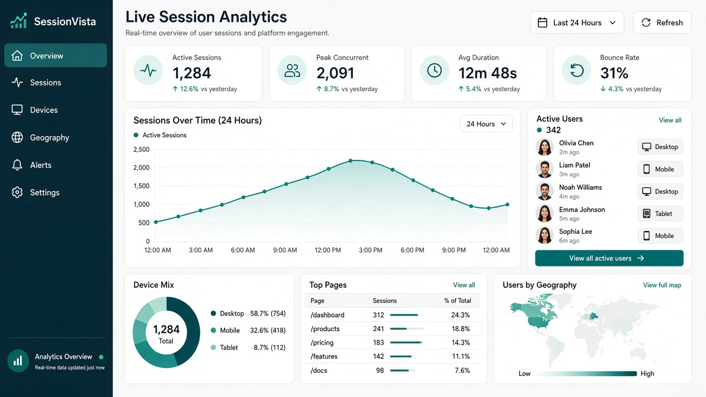
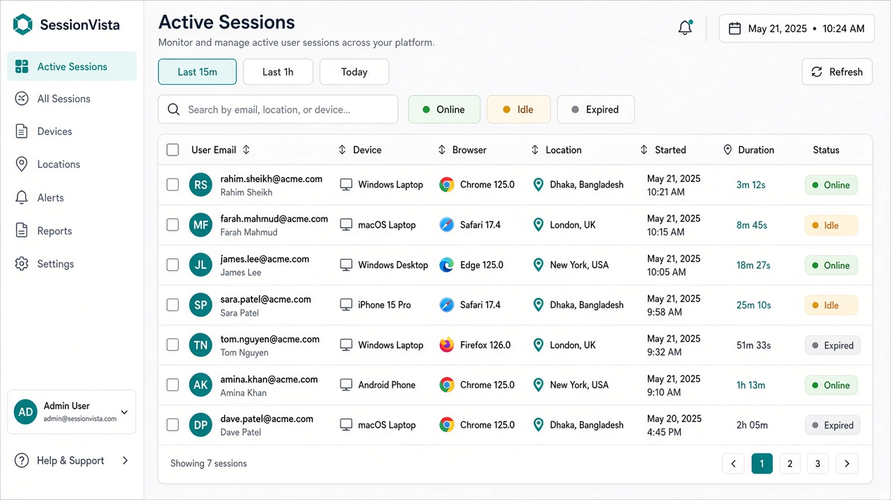
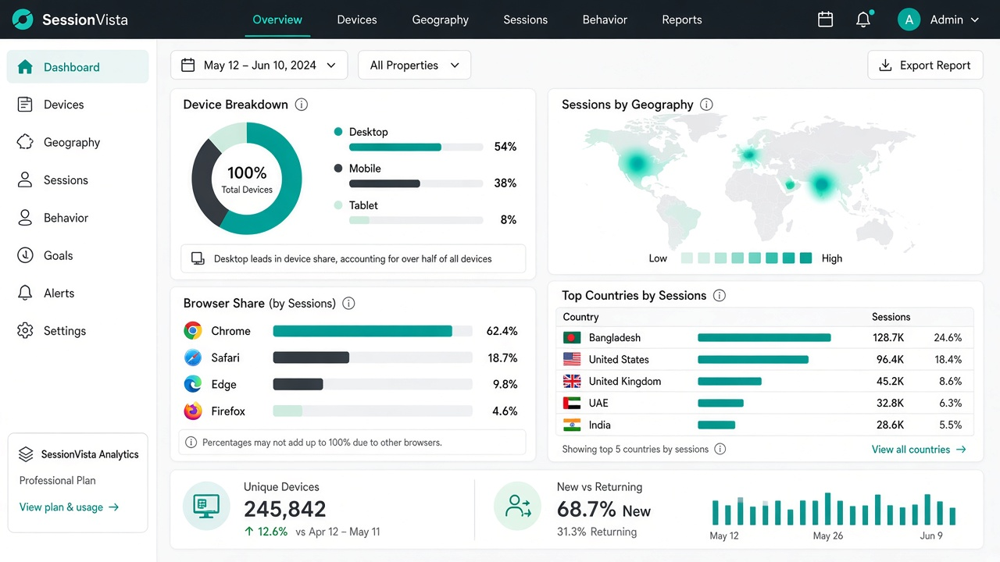

# SessionVista — Laravel Session Visual Analytics

**SessionVista** is a complete, production-ready Laravel package for **real-time session tracking, device intelligence, geography insights, and a premium operations dashboard**.

Built for Laravel 11 / 12 teams that need business-grade visibility — not a bare metrics dump.

| | |
|---|---|
| **Package** | `imranbru99/laravel-session-visual-analytics` |
| **Author** | Imran Ahmed |
| **License** | MIT |
| **Demo site** | [`/demo/index.html`](./demo/index.html) |
| **Dashboard demo** | [`/demo/dashboard.html`](./demo/dashboard.html) |
| **Support / future work** | [imrandev.bd/contact](https://imrandev.bd/contact) |

---

## Dashboard preview

### Overview


### Sessions


### Devices & geography


---

## Features

- **Live session radar** — online / idle / expired with automatic status transitions
- **Premium admin UI** — Overview, Sessions, Devices & Geo (Manrope + Sora, teal/navy business look)
- **Device & browser parsing** — desktop, mobile, tablet, bot + Chrome/Safari/Edge/Firefox/Opera
- **Engagement KPIs** — active sessions, sessions today, average duration, bounce rate
- **24-hour activity chart** — Chart.js line series from page-view events
- **Top pages & countries** — path leaderboard + optional GeoIP enrichment
- **JSON overview API** — `/session-vista/api/overview` for custom widgets
- **Safe by default** — analytics failures never break the host app; dashboard routes use `web` + `auth`
- **Publishable** — config, migrations, and Blade views
- **Standalone marketing + demo website** included in `/demo`

---

## Requirements

- PHP 8.2+
- Laravel 11 or 12
- Database driver that supports `TIMESTAMPDIFF` for average duration (MySQL/MariaDB). Swap the duration query for PostgreSQL if needed.

---

## Installation

```bash
composer require imranbru99/laravel-session-visual-analytics
```

If you are using this repository directly (path repository / VCS):

```bash
composer config repositories.session-vista path ./laravel-session-visual-analytics
composer require imranbru99/laravel-session-visual-analytics:@dev
```

Publish assets:

```bash
php artisan vendor:publish --tag=session-vista-config
php artisan vendor:publish --tag=session-vista-migrations
php artisan vendor:publish --tag=session-vista-views
php artisan migrate
```

Open the dashboard (authenticated users):

```text
/session-vista
/session-vista/sessions
/session-vista/devices
/session-vista/api/overview
```

Open the static product website / interactive demo:

```text
demo/index.html
demo/dashboard.html
```

---

## Configuration

`config/session-visual-analytics.php`

| Key | Purpose |
|-----|---------|
| `name` | Brand label in the UI (default `SessionVista`) |
| `path` | URL prefix (default `session-vista`) |
| `middleware` | Route middleware stack (default `web`, `auth`) |
| `track.enabled` | Auto-attach tracking middleware to the `web` group |
| `track.exclude_paths` | Skip dashboard / telescope / livewire / etc. |
| `track.idle_after_minutes` | Mark sessions idle |
| `track.expire_after_minutes` | Mark sessions expired |
| `retention_days` | Suggested retention window for cleanup jobs |
| `geo.driver` | `none` or `http` |
| `geo.http_url` | Template like `https://ipapi.co/{ip}/json/` |

Example `.env`:

```env
SESSION_VISTA_NAME="SessionVista"
SESSION_VISTA_PATH=session-vista
SESSION_VISTA_TRACK=true
SESSION_VISTA_RETENTION_DAYS=90
SESSION_VISTA_GEO_DRIVER=none
# SESSION_VISTA_GEO_DRIVER=http
# SESSION_VISTA_GEO_URL=https://ipapi.co/{ip}/json/
```

---

## How it works

1. `TrackSessionVista` middleware records safe GET/HEAD requests after the response.
2. Rows land in `session_vista_sessions` + `session_vista_events`.
3. The dashboard reads KPIs, charts, device mix, top pages, and recent users.
4. Status is refreshed from `last_seen_at` using idle/expire thresholds.

Facade helper:

```php
use Imranbru99\SessionVisualAnalytics\Facades\SessionVista;

$metrics = SessionVista::overviewMetrics();
$devices = SessionVista::deviceMix();
```

---

## Project structure

```text
├── composer.json
├── config/session-visual-analytics.php
├── database/migrations/
├── demo/                      # Premium marketing site + interactive dashboard
├── docs/images/               # Dashboard screenshots for README
├── resources/views/           # Blade UI (Overview / Sessions / Devices)
├── routes/web.php
├── src/
│   ├── Facades/SessionVista.php
│   ├── Http/Controllers/
│   ├── Http/Middleware/
│   ├── Models/
│   ├── Services/
│   └── SessionVisualAnalyticsServiceProvider.php
└── tests/
```

---

## Testing

```bash
composer install
vendor/bin/phpunit
```

---

## Roadmap ideas (custom work available)

- Real-time WebSocket / Reverb push for concurrent gauges
- Session force-logout / revoke from the dashboard
- Heatmaps and funnel timelines
- Multi-tenant SaaS mode with team workspaces
- PostgreSQL-optimized analytics queries
- Export to CSV / BI warehouses

For any of the above, contact the author below.

---

## Author & future development

**Imran Ahmed** — Senior Full-Stack & AI Engineer  
Dhaka, BD / Remote Worldwide

| Channel | Link |
|---------|------|
| Portfolio | [imrandev.bd](https://imrandev.bd) |
| Contact hub | [imrandev.bd/contact](https://imrandev.bd/contact) |
| Email | [me@imrandev.bd](mailto:me@imrandev.bd) |
| WhatsApp | [+880 1576-918420](https://wa.me/8801576918420) |
| GitHub | [github.com/imranbru99](https://github.com/imranbru99) |
| LinkedIn | [linkedin.com/in/imranbru99](https://linkedin.com/in/imranbru99) |
| X / Twitter | [@imrandev_bd](https://x.com/imrandev_bd) |
| YouTube | [@ImranDevBD](https://youtube.com/@ImranDevBD) |
| Instagram | [@imranbru99](https://instagram.com/imranbru99) |
| Facebook | [ExpertImranDev](https://facebook.com/ExpertImranDev) |
| TikTok | [@imrandev_bd](https://tiktok.com/@imrandev_bd) |
| Threads | [@imranbru99](https://www.threads.net/@imranbru99) |
| Pinterest | [@imrandev_bd](https://pinterest.com/imrandev_bd) |
| Linktree | [linktr.ee/ExpertImranDev](https://linktr.ee/ExpertImranDev) |

Need architecture reviews, Laravel package hardening, Next.js products, or AI pipelines after handover? Start here: **[https://imrandev.bd/contact](https://imrandev.bd/contact)**

---

## Footer / contact

© 2026 **Imran Ahmed** · SessionVista / Laravel Session Visual Analytics  

**Future development & retainers:** [imrandev.bd/contact](https://imrandev.bd/contact) · [me@imrandev.bd](mailto:me@imrandev.bd) · WhatsApp [+880 1576-918420](https://wa.me/8801576918420) · GitHub [@imranbru99](https://github.com/imranbru99)
